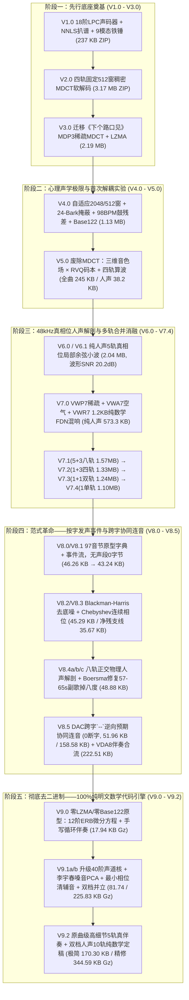

# 《李宇春 - 下个，路口，见》纯代码音乐合成工程：V1.0 → V9.2 全代际完整演进档案

**归档日期**：2026-11-15  
**基准母带曲目**：《李宇春 - 下个，路口，见》（词曲：李宇春 / 编曲：谭伊哲，全长 `210.373 秒` / `3分30秒`，`98.00 BPM`）  
**原始音频体积基准**：
- `48 kHz / 16-bit` 双声道无损 WAV：`40,391,724 Bytes`（**`40.39 MB`** / `1,536 kbps`）
- `320 kbps` 原版立体声 MP3：`9,620,866 Bytes`（**`9.62 MB`**）

> [!IMPORTANT]
> **九代演进主线一句话总结**：工程经历了**五次根本性范式跃迁**——从早期的 **LPC 声码器与 MDCT 频谱软解码（V1–V4）**，到首次尝试 **梅尔音色解耦（V5）**，再到 **48kHz 真相位多轨解剖与轨数合并消融实验（V6–V7.4）**，随后打破“固定毫秒时钟切帧”枷锁跨入 **事件音节字典 + `--` 跨字逆向协同连音（V8.0–V8.5）**，最终彻底斩断 `LZMA / Base122` 二进制压缩壳，建成 **100% 人类可读纯明文 JavaScript 数学物理方程 10 轨引擎（V9.0–V9.2，极简全曲 Gzip 仅 `170.30 KB`）**。

---

## 一、V1.0 → V9.2 五大代际演进全景图

---

## 二、全 26 个大小版本核心指标总览表

| 版本号 | 所属工程目录 | 轨道架构 | 核心编码 / 数学范式 | 压缩体积（紧凑 / 极简档） | 压缩体积（保真 / 精修档） | 客观指标 / 关键得失 |
| :--- | :--- | :---: | :--- | ---: | ---: | :--- |
| **V1.0** | [鹈鹕骑行_CPU合成试听](file:///Users/weckham/Desktop/MUSIC/%E9%B9%88%E9%B9%95%E9%AA%91%E8%A1%8C_CPU%E5%90%88%E6%88%90%E8%AF%95%E5%90%AC) | 3 轨 | `12kHz` 18阶 LPC `CPV1` + NNLS 吉他音符 + 9阶模态打铁 | `42.3 KB` (纯旋律) / `237.4 KB` (含人声) | — | 跑通零录音 `AudioWorklet`，但 LPC 人声电子感强 |
| **V2.0** | [鹈鹕骑行_纯代码合成](file:///Users/weckham/Desktop/MUSIC/%E9%B9%88%E9%B9%95%E9%AA%91%E8%A1%8C_%E7%BA%AF%E4%BB%A3%E7%A0%81%E5%90%88%E6%88%90) *(基线)* | 4 轨 | 固定 `512` 窗稠密 MDCT 频谱帧软解码 | — | `3.17 MB` (`3,319,163 B`) | 唱词可听懂，但未做稀疏与熵分离，体积大 |
| **V3.0** | [下个路口见_纯代码合成](file:///Users/weckham/Desktop/MUSIC/%E4%B8%8B%E4%B8%AA%E8%B7%AF%E5%8F%A3%E8%A7%81_%E7%BA%AF%E4%BB%A3%E7%A0%81%E5%90%88%E6%88%90) *(初版)* | 4 轨 | 首次迁移《下个路口见》：同相四轨分离 + `MDP3` 稀疏 MDCT + LZMA | `2.19 MB` (`2,185,632 B`) | `5.41 MB` (`5,413,298 B`) | 单页 HTML `2.98 MB`；短窗难聚拢稳态长音，双层 Base64 膨胀 |
| **V4.0** | [下个路口见_纯代码合成](file:///Users/weckham/Desktop/MUSIC/%E4%B8%8B%E4%B8%AA%E8%B7%AF%E5%8F%A3%E8%A7%81_%E7%BA%AF%E4%BB%A3%E7%A0%81%E5%90%88%E6%88%90) | 4 轨 | `2048/512` 自适应窗 + 24-Bark 掩蔽 + 鼓闭环残差 + `Base122` | `1.13 MB` (`1,131,172 B`) | `2.59 MB` (`2,586,755 B`) | Core SNR `19.06 dB`；本质仍是“JS 软解码器 + 频谱流” |
| **V5.0** | [下个路口见_数学波码合成](file:///Users/weckham/Desktop/MUSIC/%E4%B8%8B%E4%B8%AA%E8%B7%AF%E5%8F%A3%E8%A7%81_%E6%95%B0%E5%AD%A6%E6%B3%A2%E7%A0%81%E5%90%88%E6%88%90) | 4 轨 | 废除 MDCT：李宇春三维音色场 $\otimes$ RVQ 码本 + 模态鼓/非谐弦贝斯/旋子弦阵 | **`245.4 KB`** *(人声仅 `38.2 KB`)* | `370.9 KB` *(人声 `58.6 KB`)* | 器乐物理模型大获成功；但人声丢真相位与字头瞬态，塑料感重 |
| **V6.0** | [下个路口见_人声多轨波码](file:///Users/weckham/Desktop/MUSIC/%E4%B8%8B%E4%B8%AA%E8%B7%AF%E5%8F%A3%E8%A7%81_%E4%BA%BA%E5%A3%B0%E5%A4%9A%E8%BD%A8%E6%B3%A2%E7%A0%81) *(初版)* | 纯人声 5 轨 | `48kHz` 真相位局部余弦小波五轨正交解剖（零伴奏） | `2.04 MB` (`2,037,451 B`) | `4.26 MB` | 波形 SNR 跃至 `20.23 / 26.13 dB`，但真相位全存体积反弹 |
| **V6.1** | [下个路口见_人声多轨波码](file:///Users/weckham/Desktop/MUSIC/%E4%B8%8B%E4%B8%AA%E8%B7%AF%E5%8F%A3%E8%A7%81_%E4%BA%BA%E5%A3%B0%E5%A4%9A%E8%BD%A8%E6%B3%A2%E7%A0%81) *(热修)* | 纯人声 5 轨 | 修复 ES Module Worker 严格模式下 `lzma-d-min.js` `this` 未定义崩溃 | `2.04 MB` | `4.26 MB` | 打通多线程 Worker 并发解码与 `00:22.6` 起唱秒播 |
| **V7.0** | [下个路口见_人声多轨波码](file:///Users/weckham/Desktop/MUSIC/%E4%B8%8B%E4%B8%AA%E8%B7%AF%E5%8F%A3%E8%A7%81_%E4%BA%BA%E5%A3%B0%E5%A4%9A%E8%BD%A8%E6%B3%A2%E7%A0%81) | 纯人声 5 轨 | `VWP7` ZigZag + `VWA7` `8ms` 齿音空气 + `VWR7` `1.2KB` 8线 FDN | **`573.3 KB`** (`587,038 B`) | `1.22 MB` (`1,253,027 B`) | 纯人声省 `71%+`（混响省 `99.7%`），Mel SNR `19.82 dB` |
| **V7.1** | [下个路口见_全曲多轨合成](file:///Users/weckham/Desktop/MUSIC/%E4%B8%8B%E4%B8%AA%E8%B7%AF%E5%8F%A3%E8%A7%81_%E5%85%A8%E6%9B%B2%E5%A4%9A%E8%BD%A8%E5%90%88%E6%88%90) | 全曲 8 轨 (`5+3`) | 5 轨人声 + 3 轨伴奏（贝斯 / 鼓 / 吉他合成器）全曲合流 | `1.57 MB` (`1,642,544 B`) | `3.36 MB` (`3,519,114 B`) | `62.5 kbps`，支持清唱 / KTV / 8轨独立调音 |
| **V7.2** | [下个路口见_四轨全曲合成](file:///Users/weckham/Desktop/MUSIC/%E4%B8%8B%E4%B8%AA%E8%B7%AF%E5%8F%A3%E8%A7%81_%E5%9B%9B%E8%BD%A8%E5%85%A8%E6%9B%B2%E5%90%88%E6%88%90) | 全曲 4 轨 (`1+3`) | 5 轨人声合为 1 轨立体声人声（`329.8 KB`，消除分频重复税）+ 3 轨伴奏 | `1.33 MB` (`1,394,211 B`) | `2.86 MB` (`3,003,407 B`) | `53.0 kbps`，Mel SNR 反升至 `17.53 dB` |
| **V7.3** | [下个路口见_双轨全曲合成](file:///Users/weckham/Desktop/MUSIC/%E4%B8%8B%E4%B8%AA%E8%B7%AF%E5%8F%A3%E8%A7%81_%E5%8F%8C%E8%BD%A8%E5%85%A8%E6%9B%B2%E5%90%88%E6%88%90) | 全曲 2 轨 (`1+1`) | 1 轨立体声人声 + 1 轨未拆解完整立体声伴奏（消除 AI 拆鼓损耗） | `1.24 MB` (`1,300,155 B`) | `2.58 MB` (`2,709,680 B`) | `49.4 kbps`，Mel SNR 升至 `17.86 dB` |
| **V7.4** | [下个路口见_单轨全曲合成](file:///Users/weckham/Desktop/MUSIC/%E4%B8%8B%E4%B8%AA%E8%B7%AF%E5%8F%A3%E8%A7%81_%E5%8D%95%E8%BD%A8%E5%85%A8%E6%9B%B2%E5%90%88%E6%88%90) / [下个路口见_多轨合并对比台](file:///Users/weckham/Desktop/MUSIC/%E4%B8%8B%E4%B8%AA%E8%B7%AF%E5%8F%A3%E8%A7%81_%E5%A4%9A%E8%BD%A8%E5%90%88%E5%B9%B6%E5%AF%B9%E6%AF%94%E5%8F%B0) | 全曲 1 轨 (`1`) & 四方案同台 | 全曲母带 `Mid+Side+Air` 合一编码 + `5+3/1+3/1+1/1` 无缝盲听对比台 | `1.10 MB` (`1,155,511 B`) | `2.52 MB` (`2,647,469 B`) | 证明固定毫秒帧切片的天花板卡在 `~1.1 MB` |
| **V8.0** | [下个路口见_事件音节波码](file:///Users/weckham/Desktop/MUSIC/%E4%B8%8B%E4%B8%AA%E8%B7%AF%E5%8F%A3%E8%A7%81_%E4%BA%8B%E4%BB%B6%E9%9F%B3%E8%8A%82%E6%B3%A2%E7%A0%81) *(初版)* | 纯人声 4 层 | **事件音节衍生**：97 音节字典 + 歌手核 + 事件轨迹（无声段 `0 B`） | **`46.26 KB`** (`47,375 B`) | `118.58 KB` (`121,429 B`) | `1.80 kbps` 破纪录！但 Hann 窗泄漏与 IFFT 分帧有沙沙底噪 |
| **V8.1** | [下个路口见_事件音节波码](file:///Users/weckham/Desktop/MUSIC/%E4%B8%8B%E4%B8%AA%E8%B7%AF%E5%8F%A3%E8%A7%81_%E4%BA%8B%E4%BB%B6%E9%9F%B3%E8%8A%82%E6%B3%A2%E7%A0%81) *(过渡)* | 纯人声 4 层 | 音节锚点步长与事件流残差紧凑重排 | `43.24 KB` (`44,281 B`) | `109.42 KB` (`112,045 B`) | 压缩率进一步提升，底噪根因待底层窗函数净化 |
| **V8.2** | [下个路口见_事件音节波码](file:///Users/weckham/Desktop/MUSIC/%E4%B8%8B%E4%B8%AA%E8%B7%AF%E5%8F%A3%E8%A7%81_%E4%BA%8B%E4%BB%B6%E9%9F%B3%E8%8A%82%E6%B3%A2%E7%A0%81) *(净音)* | 纯人声 4 层 | `-92dB` Blackman-Harris 窗 + 元音 `<4.5kHz` 清零 + Chebyshev 逐采样连续相位 | `45.29 KB` | `110.99 KB` | 剥离噪声垃圾熵后 SNR 升至 `19.98 dB`、体积比 V8.0 更小 |
| **V8.3** | [下个路口见_纯净事件音节波码](file:///Users/weckham/Desktop/MUSIC/%E4%B8%8B%E4%B8%AA%E8%B7%AF%E5%8F%A3%E8%A7%81_%E7%BA%AF%E5%87%80%E4%BA%8B%E4%BB%B6%E9%9F%B3%E8%8A%82%E6%B3%A2%E7%A0%81) | 纯人声 4 层 | 跨轨去伴奏串音（清零假音节）+ `48kHz` 原生无混叠 FDN（仅 `68 B`） | **`35.67 KB`** (`36,524 B`) | `75.66 KB` (`77,479 B`) | `1.39 kbps`、有声 HNR `30.06 dB`，但 18 阶倒谱高频偏紧 |
| **V8.4a** | [下个路口见_事件音节波码](file:///Users/weckham/Desktop/MUSIC/%E4%B8%8B%E4%B8%AA%E8%B7%AF%E5%8F%A3%E8%A7%81_%E4%BA%8B%E4%BB%B6%E9%9F%B3%E8%8A%82%E6%B3%A2%E7%A0%81) | 纯人声 4 轨 | 吸收 `CheapTrick + D4C + CombSub + Klatt` 重构 40 维声道核 | `46.91 KB` | `157.50 KB` | 修复高频塌陷，但 4 轨耦合仍不够透彻 |
| **V8.4b** | [下个路口见_事件音节波码](file:///Users/weckham/Desktop/MUSIC/%E4%B8%8B%E4%B8%AA%E8%B7%AF%E5%8F%A3%E8%A7%81_%E4%BA%8B%E4%BB%B6%E9%9F%B3%E8%8A%82%E6%B3%A2%E7%A0%81) | 纯人声 8 轨 | 拆分为 **8 轨正交物理发声解剖**（胸腔/元音/丝绒泛音/爆破/擦音/开相气声/伴唱/FDN） | `~48 KB` | `~140 KB` | 干声 SNR `20.98 dB`，但 `57s–65s` 副歌因 F0 上限 `370Hz` 掉八度 |
| **V8.4c** | [下个路口见_事件音节波码](file:///Users/weckham/Desktop/MUSIC/%E4%B8%8B%E4%B8%AA%E8%B7%AF%E5%8F%A3%E8%A7%81_%E4%BA%8B%E4%BB%B6%E9%9F%B3%E8%8A%82%E6%B3%A2%E7%A0%81) | 纯人声 8 轨 | Boersma 无偏自相关 (`170–526 Hz`) + LRC 短语配额根除副歌掉八度与吞字 | `48.88 KB` | `138.65 KB` | 副歌 `A4 (440Hz)` 精准还原；遗留单字孤立 `99` 处微断口 |
| **V8.5** | [下个路口见_事件音节波码](file:///Users/weckham/Desktop/MUSIC/%E4%B8%8B%E4%B8%AA%E8%B7%AF%E5%8F%A3%E8%A7%81_%E4%BA%8B%E4%BB%B6%E9%9F%B3%E8%8A%82%E6%B3%A2%E7%A0%81) | 纯人声 8 轨 | **DAC 跨字 `--` 逆向预期协同连音** + 零断字气流桥 + Side 差分锁准「弗朗明哥」 | **`51.96 KB`** (`53,209 B`) | **`158.58 KB`** (`162,382 B`) | 句内断口 **`0 处`**，`H1..10 RMSE 4.36 dB`，方差捕获 `99.58%` |
| **V8.5+V5** | [下个路口见_事件音节波码](file:///Users/weckham/Desktop/MUSIC/%E4%B8%8B%E4%B8%AA%E8%B7%AF%E5%8F%A3%E8%A7%81_%E4%BA%8B%E4%BB%B6%E9%9F%B3%E8%8A%82%E6%B3%A2%E7%A0%81) | 全曲 11 轨 (`8+3`) | V8.5 八轨人声 (`51.96 KB`) + V5 紧凑三轨伴奏 (`~207 KB`) | `259.22 KB` | — | 全曲合流首测，仍带 `LZMA + Base122` 二进制壳 |
| **V8.5+V8Dict** | [下个路口见_事件音节波码](file:///Users/weckham/Desktop/MUSIC/%E4%B8%8B%E4%B8%AA%E8%B7%AF%E5%8F%A3%E8%A7%81_%E4%BA%8B%E4%BB%B6%E9%9F%B3%E8%8A%82%E6%B3%A2%E7%A0%81) | 全曲 11 轨 (`8+3`) | V8.5 八轨人声 (`51.96 KB`) + `VDA8` 小节波形字典伴奏 (`170.55 KB`) | **`222.51 KB`** (`227,852 B`) | `2,371.55 KB` *(配V7高精伴奏)* | 二进制编码路线终点（`8.66 kbps`），仍依赖 LZMA 二进制 |
| **V9.0** | [下个路口见_纯数学代码引擎_V9.0固化](file:///Users/weckham/Desktop/MUSIC/%E4%B8%8B%E4%B8%AA%E8%B7%AF%E5%8F%A3%E8%A7%81_%E7%BA%AF%E6%95%B0%E5%AD%A6%E4%BB%A3%E7%A0%81%E5%BC%95%E6%93%8E_V9.0%E5%9B%BA%E5%8C%96) | 全曲 10 轨 (`5+5`) | **100% 明文数学代码（零 LZMA/Base122）**：12阶 ERB 二阶微分方程 + 4和弦手写循环 | **`17.94 KB` Gz** *(明文 `48.37 KB`)* | — | 架构彻底纯代码化，但 12 阶声道过粗，听不出李宇春音色 |
| **V9.1a** | [下个路口见_纯数学代码引擎](file:///Users/weckham/Desktop/MUSIC/%E4%B8%8B%E4%B8%AA%E8%B7%AF%E5%8F%A3%E8%A7%81_%E7%BA%AF%E6%95%B0%E5%AD%A6%E4%BB%A3%E7%A0%81%E5%BC%95%E6%93%8E) *(单档)* | 全曲 10 轨 (`5+5`) | 40阶 ERB 声道核 + 李宇春 10维 PCA 微表情 + 最小相位清辅音纯明文化 | `79.69 KB` Gz *(人声 `76.75 KB`)* | — | 李宇春本人嗓音与咬字清晰还原，仅单档且伴奏简略 |
| **V9.1b** | [下个路口见_纯数学代码引擎](file:///Users/weckham/Desktop/MUSIC/%E4%B8%8B%E4%B8%AA%E8%B7%AF%E5%8F%A3%E8%A7%81_%E7%BA%AF%E6%95%B0%E5%AD%A6%E4%BB%A3%E7%A0%81%E5%BC%95%E6%93%8E) *(双档)* | 全曲 10 轨 (`5+5`) | 双档人声纯代码并立（10维极简 + 24维精修）+ `2.94 KB` 手写伴奏 | `81.74 KB` Gz *(明文 `273.53 KB`)* | `225.83 KB` Gz *(明文 `769.64 KB`)* | 人声双档齐备，但 `2.94 KB` 手写伴奏丢失原曲编曲细节 |
| **V9.2** | [下个路口见_纯数学代码引擎_V9.2固化](file:///Users/weckham/Desktop/MUSIC/%E4%B8%8B%E4%B8%AA%E8%B7%AF%E5%8F%A3%E8%A7%81_%E7%BA%AF%E6%95%B0%E5%AD%A6%E4%BB%A3%E7%A0%81%E5%BC%95%E6%93%8E_V9.2%E5%9B%BA%E5%8C%96) | **全曲 10 轨 (`5+5`)** | **100% 纯明文数学代码定稿**：双档李宇春声学模型 + 原曲级 5 轨真细节纯数学伴奏 | **`170.30 KB` Gz** *(明文 `613.96 KB`)* | **`344.59 KB` Gz** *(明文 `1,233.23 KB`)* | **零二进制/零LZMA，Gzip 反超 `222.51 KB` 二进制包，全曲细节完整还原** |

---

## 三、逐版本深度演进全记录（V1.0 → V9.2）

### 第一阶段：先行方法论奠基期（V1.0 – V3.0）

#### `V1.0` — 18 阶 LPC 线性预测声码器 + NNLS 器乐扒谱 + 模态打击合成
- **工程归档**：[鹈鹕骑行_CPU合成试听](file:///Users/weckham/Desktop/MUSIC/%E9%B9%88%E9%B9%95%E9%AA%91%E8%A1%8C_CPU%E5%90%88%E6%88%90%E8%AF%95%E5%90%AC)（验证曲长 `174.64s`）
- **核心设计**：
  1. **人声 (`CPV1` 格式)**：在 `12 kHz` 采样率、每 `20ms`（`240` 采样）提取基频 `F0`、响度、清浊音标志与 **18 阶 Levinson-Durbin 线性预测反射系数**（共 `8,734` 帧，`349,376 B` 裸参数），在浏览器 `AudioWorklet` 中用全极点晶格滤波器实时激励发声。
  2. **木吉他**：非负最小二乘（NNLS）谐波模板自动转写为 `1,430` 条 `[onset, duration, midi, strength, pan]` 音符事件。
  3. **金属打击瞬态**：拟合前 `9` 阶共振峰频率与指数衰减常数，用模态合成（Modal Synthesis）还原 `545` 次敲击。
- **实测数据**：纯旋律包 ZIP 仅 `42.29 KB`（`43,305 B`），含 LPC 人声完整包 ZIP `237.45 KB`（`243,147 B`），单核 CPU 实时占用仅 `3.17%`（`30.3×` 实时倍率）。
- **暴露痛点**：`12 kHz` 18 阶全极点 LPC 丢失了高频唇齿音与声门真实相位，中文演唱带有浓重的古典电子声码器（Vocoder）机器鼻音。

#### `V2.0` — 四轨固定窗 512 点稠密 MDCT 频谱软解码初版
- **工程归档**：[鹈鹕骑行_纯代码合成](file:///Users/weckham/Desktop/MUSIC/%E9%B9%88%E9%B9%95%E9%AA%91%E8%A1%8C_%E7%BA%AF%E4%BB%A3%E7%A0%81%E5%90%88%E6%88%90) 前置 V2 基准
- **核心设计**：放弃有损 LPC 参数假设，按 **主唱 (`vocal`)、木吉他 (`guitar`)、瞬态打击 (`iron`)、余音立体声场 (`room` Mid/Side)** 四轨分离，对每轨做固定 `512` 点窗改进离散余弦变换（MDCT）量化，由纯 JS 在 `AudioWorklet` 内逐块逆变换重叠相加（OLA）。
- **实测数据**：整包 ZIP `3.17 MB`（`3,319,163 B`）。
- **暴露痛点**：唱词清晰度彻底解决，但固定步幅稠密存储了大量近零频谱系数，体积突破 `3 MB`。

#### `V3.0` — 稀疏 `MDP3` 熵分离编码 + 首次迁移落地《李宇春 - 下个，路口，见》
- **工程归档**：[鹈鹕骑行_纯代码合成](file:///Users/weckham/Desktop/MUSIC/%E9%B9%88%E9%B9%95%E9%AA%91%E8%A1%8C_%E7%BA%AF%E4%BB%A3%E7%A0%81%E5%90%88%E6%88%90) → 正式迁移构建《下个，路口，见》首版 [下个路口见_纯代码合成](file:///Users/weckham/Desktop/MUSIC/%E4%B8%8B%E4%B8%AA%E8%B7%AF%E5%8F%A3%E8%A7%81_%E7%BA%AF%E4%BB%A3%E7%A0%81%E5%90%88%E6%88%90)
- **核心设计**：
  1. 使用 Apple Silicon MPS 共同相位（Coherent-Phase）分离出 **主唱 (`vocal-mid`)、鼓组 (`drums-mid`)、贝斯 (`bass-mid`)、吉他键盘声场 (`harmony` Mid+Side)** 四轨，四轨线性相加与原混音最大误差仅 `1.19e-7`。
  2. 设计 `MDP3` 稀疏格式：将非零谱线位置位图、正负符号流、幂律量化幅度与子带缩放因子拆成四条同质流再交由 `LZMA` 无损压缩。
- **《下个，路口，见》V3 实测数据**：
  - `compact` 紧凑版四轨合计：**`2.19 MB`**（`2,185,632 B`，其中人声 `654 KB`、鼓组 `892 KB`、贝斯 `42.6 KB`、吉他键盘 `597 KB`）；
  - `faithful` 保真版四轨合计：**`5.41 MB`**（`5,413,298 B`）；
  - 自包含单文件 HTML：**`2.98 MB`**（`2,979,817 B`）。
- **暴露痛点**：① 固定 `512` 短窗频率分辨率粗，持续元音与贝斯长音的谐波散落在多根谱线上；② 鼓组 `86` 小节重复节拍被逐帧重复编码占了 `892 KB`；③ 单文件 HTML 内含 Gzip + 双层 Base64 套娃（净膨胀 `33.33%`）。

---

### 第二阶段：心理声学变换极限与第一次“真纯代码”追问（V4.0 – V5.0）

#### `V4.0` — 5 模态自适应长短窗 + 24-Bark 心理声学掩蔽 + 98 BPM 鼓闭环残差 + UTF-8 Base122
- **工程归档**：[下个路口见_纯代码合成](file:///Users/weckham/Desktop/MUSIC/%E4%B8%8B%E4%B8%AA%E8%B7%AF%E5%8F%A3%E8%A7%81_%E7%BA%AF%E4%BB%A3%E7%A0%81%E5%90%88%E6%88%90)（本地服务端口 `8925`）
- **核心设计**：
  1. **5 模态 Princen-Bradley 长短窗切换**：稳态段（人声占 `91.1%`）用 `2048` 长窗聚拢谐波，咬字爆破与鼓点瞬态切至 `4×512` 短窗并通过桥接窗严格满足 TDAC 混叠抵消。
  2. **24-Bark 临界频带同时掩蔽 + `0.50 dB` 跨帧对数差分**：将比特优先倾斜给 `150 Hz – 4.2 kHz` 人声共振峰（47/63 阶量化），剔除听阈下不可闻噪声。
  3. **CELT 高频参数立体声频谱折叠（PS + PNS）**：高频侧向声场仅存子带能量包络，解码端确定性去相关折叠。
  4. **`98.00 BPM` 鼓组闭环原型字典 + 稀疏残差**：仅用 `4` 小节鼓原型（`71.5 KB`）捕获全曲 `90.0%` 鼓组能量，再对解码后原型做闭环相减保留过门残差（`224.6 KB`）。
  5. **无套娃 `UTF-8 Base122` 文本封装**：安全绕过 `NUL / LF / CR / " / < / \` 6 个非法字节，文本编码膨胀率从 Base64 的 `33.33%` 压至 `14.29%`。
- **实测数据**：
  - `compact` 紧凑版：**`1.13 MB`**（`1,131,172 B`，较 V3 缩减 `-48.2%`，其中人声 `480.6 KB`，`<4.2 kHz` 核心频段 SNR `19.06 dB`）；
  - `faithful` 保真版：**`2.59 MB`**（`2,586,755 B`，核心 SNR `24.93 dB`）；
  - 单文件离线 HTML：**`1.33 MB`**（`1,330,565 B`，较 V3 缩减 `-55.3%`）。
- **关键思想转折（第一次哲学拷问）**：
  - 用户追问：*“严格意思上，咱们是真的纯代码么？真人的声音分发音和音色，是不是还能进一步拆分和数学代码化？”*
  - 复盘确认 V4 本质仍是“手写软解码器 + 逐 `21ms` 频谱帧压缩流”，由此开启向**物理发声方程与发音-音色解耦**的第一次冲击。

#### `V5.0` — AI 梅尔谱「三维生理音色场 × RVQ 发音码本」正交解耦 + 四轨波函数实时算波
- **工程归档**：[下个路口见_数学波码合成](file:///Users/weckham/Desktop/MUSIC/%E4%B8%8B%E4%B8%AA%E8%B7%AF%E5%8F%A3%E8%A7%81_%E6%95%B0%E5%AD%A6%E6%B3%A2%E7%A0%81%E5%90%88%E6%88%90)（端口 `8926`）
- **核心设计（全工程 0 MDCT 频谱帧）**：
  1. **人声 (`vocal-wave`)**：分解为李宇春静态 48-Mel 三维生理音色核 $\mathcal{T}_{\text{LYC}}(m, f_0, g)$（平均嗓音共鸣 + 音高寄存器斜率 + 力度倾斜）$\otimes$ `256×128` 残差矢量量化（RVQ）发音口型码本 + `64` 点实倒谱最小相位谐波合成。
  2. **鼓组 (`drums-wave` / `WVD5`)**：`58.59 Hz` 指数扫频底鼓微分模态 + `164.06 Hz` 木鱼/军鼓腔体模态 + NMF 打击瞬态频谱包络。
  3. **贝斯 (`bass-wave` / `WVB5`)**：18 阶非谐波刚度色散弦方程 \(f_k = k f_0 \sqrt{1 + 0.00018 k^2}\) + 静态拾音器泛音轮廓。
  4. **吉他键盘 (`harmony-wave` / `WVH5`)**：`MIDI 40..95`（56 键）耦合复数旋量复音振荡器阵列（每采样 `0` 次 `Math.sin`）+ 木吉他拨片扫弦包络 + `4×4` Householder FDN 混响。
- **实测数据**：
  - `compact` 极简解耦版：四轨总计仅 **`245.4 KB`**（`251,307 B`，**其中全曲 3分30秒人声暴降至 `38.2 KB` / `39,072 B`**，贝斯仅 `21.7 KB`），单文件 HTML **`326.4 KB`**（`334,210 B`，仅为原 MP3 的 `1/28.8`）；
  - `faithful` 高精解耦版：四轨总计 **`370.9 KB`**（`379,761 B`，人声 `58.6 KB`）。
- **暴露痛点**：器乐三轨（尤其非谐波贝斯与旋子弦阵）奠定了极佳的物理建模资产（后来直接赋能 V9.2），但**单轨 `38.2 KB` 人声损失过大**——`80 fps` 256 码本量化丢弃了真实声门脉冲相位（波形 SNR `~0 dB`）、削掉了 `>12 kHz` 唇齿空气，且把占能量 30% 的副歌双声道叠唱压扁成了单声道。

---

### 第三阶段：48kHz 真相位纯人声五轨解剖与多轨合并消融实验（V6.0 – V7.4）

#### `V6.0` & `V6.1` — 100% 剥离伴奏 · 纯人声五轨 48kHz 真相位局部余弦小波解剖台
- **工程归档**：[下个路口见_人声多轨波码](file:///Users/weckham/Desktop/MUSIC/%E4%B8%8B%E4%B8%AA%E8%B7%AF%E5%8F%A3%E8%A7%81_%E4%BA%BA%E5%A3%B0%E5%A4%9A%E8%BD%A8%E6%B3%A2%E7%A0%81) 初版（端口 `8928`）
- **核心设计**：
  - 响应用户 *“先把保真度彻底拉上去，做成多轨单独听人声”*，将 48kHz 立体声人声精确拆分为严格线性守恒（相加最大误差 `5.96e-8`）的 **5 条物理声学子轨**：`01` 声带基音与胸腔音色（`80–1,350 Hz`）、`02` 元音口型与高次泛音（`1,350–7,800 Hz`）、`03` 唇齿辅音与呼吸空气、`04` 副歌双声道叠唱和声、`05` 录音室混响尾音。
  - **`V6.1` 热修复**：修复 ES Module `type: 'module'` Web Worker 严格模式下 `lzma-d-min.js` 顶层 `this` 为 `undefined` 导致点击播放无响应的阻塞缺陷，并默认锚定 `00:22.6` 起唱位秒出声。
- **实测数据**：精粹版全立体声波形 SNR 跃升至 **`20.23 dB`**（Mel SNR `22.90 dB`），母带高精版达 **`26.13 dB`**（Mel SNR `28.45 dB`）；但暴力全存真相位使纯人声五轨体积涨至 **`2.04 MB`**（`2,037,451 B`）与 **`4.26 MB`**。

#### `V7.0` — `VWP7 + VWA7 + VWR7` 纯人声五轨混合参数大瘦身
- **工程归档**：[下个路口见_人声多轨波码](file:///Users/weckham/Desktop/MUSIC/%E4%B8%8B%E4%B8%AA%E8%B7%AF%E5%8F%A3%E8%A7%81_%E4%BA%BA%E5%A3%B0%E5%A4%9A%E8%BD%A8%E6%B3%A2%E7%A0%81) 定稿版
- **核心设计**：
  1. **`VWP7` 活跃子带 ZigZag 编码**：`01` 胸腔核纯无损紧缩（`76.8 KB`，保持 `33.18 dB` Mel SNR），`02` 共振峰聚焦 `3.9 Hz` 超密频栅（`141.3 KB`，省 `57.6%`）。
  2. **`VWA7` 4 频带 `8ms` 极高频空气包络**：`03` 唇齿辅音轨从 `586.9 KB` 压至 `117.6 KB`（省 `80.0%`）。
  3. **`VWR7` 纯数学 8 线 Householder FDN 混响器**：将 `05` 录音室混响轨从 `383.8 KB` 频谱流彻底替换为 **`1.2 KB`** 纯数学反馈延迟矩阵（省 **`99.7%`**，单独 Solo 亦由前置干声实时激励出湿声尾音）。
- **实测数据**：纯人声五轨精粹版从 `2.04 MB` 压至 **`573.3 KB`**（`587,038 B`，比 WAV 小 `98.55%`，Mel SNR `19.82 dB`）；母带版压至 **`1.22 MB`**（`1,253,027 B`，Mel SNR `21.93 dB`）。

#### `V7.1` → `V7.4` — 全曲伴奏回归与 `5+3 / 1+3 / 1+1 / 1` 四种轨数拓扑横向对比台
为精确量化“分轨粒度对心理声学掩蔽与文件大小的真实成本”，平行构建了四套全曲工程与一座四合一盲听对比台：
- **`V7.1` 全曲八轨版（`5+3`）** — [下个路口见_全曲多轨合成](file:///Users/weckham/Desktop/MUSIC/%E4%B8%8B%E4%B8%AA%E8%B7%AF%E5%8F%A3%E8%A7%81_%E5%85%A8%E6%9B%B2%E5%A4%9A%E8%BD%A8%E5%90%88%E6%88%90)：5 轨人声 + 3 轨伴奏（`bass / drums / accompaniment`），精粹版 **`1.57 MB`**（`1,642,544 B`，`62.5 kbps`，Mel SNR `16.76 dB`），高精版 `3.36 MB`（`3,519,114 B`）。
- **`V7.2` 全曲四轨版（`1+3`）** — [下个路口见_四轨全曲合成](file:///Users/weckham/Desktop/MUSIC/%E4%B8%8B%E4%B8%AA%E8%B7%AF%E5%8F%A3%E8%A7%81_%E5%9B%9B%E8%BD%A8%E5%85%A8%E6%9B%B2%E5%90%88%E6%88%90)：将五轨人声合并回 1 轨完整立体声人声后再编码，消除分频切口重复计费，人声从 `573.3 KB` 直降至 **`329.8 KB`**（`337,755 B`），全曲精粹版降至 **`1.33 MB`**（`1,394,211 B`，`53.0 kbps`，Mel SNR 反升至 `17.53 dB`）。
- **`V7.3` 全曲双轨版（`1+1`）** — [下个路口见_双轨全曲合成](file:///Users/weckham/Desktop/MUSIC/%E4%B8%8B%E4%B8%AA%E8%B7%AF%E5%8F%A3%E8%A7%81_%E5%8F%8C%E8%BD%A8%E5%85%A8%E6%9B%B2%E5%90%88%E6%88%90)：1 轨立体声人声（`328.9 KB`）+ 1 轨不经 Demucs 鼓/贝斯拆解的完整立体声伴奏（`940.8 KB`），消除鼓贝斯分轨串扰，精粹版 **`1.24 MB`**（`1,300,155 B`，`49.4 kbps`，Mel SNR `17.86 dB`）。
- **`V7.4` 全曲合一单轨版（`1`）& 四方案同页盲听对比台** — [下个路口见_单轨全曲合成](file:///Users/weckham/Desktop/MUSIC/%E4%B8%8B%E4%B8%AA%E8%B7%AF%E5%8F%A3%E8%A7%81_%E5%8D%95%E8%BD%A8%E5%85%A8%E6%9B%B2%E5%90%88%E6%88%90) + [下个路口见_多轨合并对比台](file:///Users/weckham/Desktop/MUSIC/%E4%B8%8B%E4%B8%AA%E8%B7%AF%E5%8F%A3%E8%A7%81_%E5%A4%9A%E8%BD%A8%E5%90%88%E5%B9%B6%E5%AF%B9%E6%AF%94%E5%8F%B0)：全曲直接按唯一立体声母带（`Mid + Side + Air`）编码，精粹版 **`1.10 MB`**（`1,155,511 B`，`43.9 kbps`，Mel SNR `18.86 dB`）。
- **阶段总结与瓶颈锁定**：结合 GPT-6.1 审阅与四方案实测证明——只要仍按“每几十毫秒切一帧”的监控录像式思维记录频谱，静音区与稳态长音就在按毫秒持续交税，人声不可能突破 `300 KB`、全曲不可能突破 `1 MB`。

---

### 第四阶段：范式革命——「事件音节衍生波码引擎」与跨字协同连音（V8.0 – V8.5）

> **核心思想源头（用户“弹琴与发声事件”洞察）**：*“MP3 一秒钟每 30 多毫秒就要生硬记一次；但唱歌其实跟着字来，一秒钟唱两个字就只需记两次事件，而且全曲汉字大量重复，同音节发音方式差不多，只需存一套音节字典 + 当次演唱表情，由代码驱动衍生出声波。”*

#### `V8.0` & `V8.1` — 97 音节声学原型字典 + 无声段零字节事件流突破
- **工程归档**：[下个路口见_事件音节波码](file:///Users/weckham/Desktop/MUSIC/%E4%B8%8B%E4%B8%AA%E8%B7%AF%E5%8F%A3%E8%A7%81_%E4%BA%8B%E4%BB%B6%E9%9F%B3%E8%8A%82%E6%B3%A2%E7%A0%81) 初版（端口 `8938`）
- **核心设计**：
  - 将全曲 `281` 个歌词汉字（含 `7-11` 英语拆音 `se-ven-yi-le-ven`）聚类为 **97 个去重音节原型字典 (`syllable_atlas`)**，平均每个音节复用 `2.94` 次（如 `di ×26`、`da ×14`）；前奏 `23s`、间奏 `21s`、尾奏 `32s` 无声区间彻底实现 **`0 Byte`**。
  - **`V8.0` 首版实测**：全曲纯人声一步从 V7 的 `573.3 KB` 暴降 **91.9%** 至 **`46.26 KB`**（`47,375 B` / `1.80 kbps`），精修档 **`118.58 KB`**（`121,429 B` / `4.62 kbps`）。
  - **`V8.1` 紧凑对齐微调**：收紧音节内部锚点与残差步长，体积一度探底至 **`43.24 KB`**（`44,281 B`）与 **`109.42 KB`**（`112,045 B`）。
- **暴露痛点**：Hann 分析窗（`-31.5 dB` 旁瓣）频谱泄漏把谐波能量误判为气声底噪，叠加谐波 IFFT 帧间相位重置，导致元音带有沙沙底噪与 `187.5 Hz` 分帧毛刺。

#### `V8.2` & `V8.3` — 剥离噪声垃圾熵与采样级切比雪夫连续相位生波
- **触发洞察**：用户指出 *“有杂音就是不干净，不干净就是有多余的数据残留”*。
- **`V8.2`（主线净音版，[下个路口见_事件音节波码](file:///Users/weckham/Desktop/MUSIC/%E4%B8%8B%E4%B8%AA%E8%B7%AF%E5%8F%A3%E8%A7%81_%E4%BA%8B%E4%BB%B6%E9%9F%B3%E8%8A%82%E6%B3%A2%E7%A0%81)）**：
  - 换用 `-92 dB` 旁瓣 4 项 Blackman-Harris 窗，元音韵母段 `100%` 清零 `<4.5 kHz` 宽带底噪（主歌气声底噪净降 `12.85 dB`），并将谐波 IFFT 彻底改写为 **48kHz 逐采样 Chebyshev 二阶三角递推连续相位振荡器**。
  - **奇妙验证**：清除不可压缩的随机噪声残余后，干声 Mel SNR 升至 `19.98 dB`，而包体积比 V8.0 更小（`ultra` **`45.29 KB`**，`expressive` **`110.99 KB`**，合成耗时仅 `1.5s`）。
- **`V8.3`（独立极限净残支线，[下个路口见_纯净事件音节波码](file:///Users/weckham/Desktop/MUSIC/%E4%B8%8B%E4%B8%AA%E8%B7%AF%E5%8F%A3%E8%A7%81_%E7%BA%AF%E5%87%80%E4%BA%8B%E4%BB%B6%E9%9F%B3%E8%8A%82%E6%B3%A2%E7%A0%81)）**：
  - 引入跨轨伴奏去串音（清除 `2` 个伴奏泄漏假音节孤岛）与原生 `48 kHz` 8 线质数 FDN（`>12 kHz` 混叠从 `1.26%` 降至 `0.009%`，混响包仅 `68 B`），有声段谐噪比 HNR 飙至 `30.06 dB`，将 4 层人声体积压至历史最低的 **`35.67 KB`**（`1.39 kbps`）/ **`75.66 KB`**；但因仅用 18 阶倒谱且 `<9.6 kHz` 滚降，高频空气感偏紧，故后续高保真攻关回到 `V8.4` 主线扩展。

#### `V8.4`（含 `V8.4a` → `V8.4b` → `V8.4c` 三轮连续攻坚）— 八轨正交物理人声解剖与副歌掉八度根治
- **命名约束**：严格遵循用户指令，在人声质感彻底打磨到位前统一在 `V8.4` 内深耕，不虚升大版本号。
- **`V8.4a`（物理声道核升级）**：融合 `World CheapTrick`、`D4C`、`pc-ddsp CombSub` 与 `Klatt` 声门倾斜纯数学模型（零 AI 权重），升级为 40 维倒谱声道核 + 64 谐波二次相位色散（`46.91 KB` / `157.50 KB`），消除高频塌陷。
- **`V8.4b`（四轨扩编为八轨正交物理发声解剖）**：响应用户 *“为啥只拆四轨？”*，将人声精细拆解为 **8 条独立可 Solo/Mute 物理音轨**：
  `01` 声带基音与胸腔共鸣（`80–720 Hz`）· `02` 核心元音口型共振（`720–3,200 Hz`）· `03` 歌手泛音丝绒光泽（`3.2–15.6 kHz`）· `04` 爆破塞擦字头瞬态（`VOT < 40ms`）· `05` 唇齿平翘舌清擦音 · `06` Klatt 开相调制真气声 · `07` 副歌双声道真伴唱 · `08` 4抽头早期反射 + 8线 FDN 混响。
- **`V8.4c`（`57s–65s` 与三段副歌垮掉根因修复）**：
  - 用户精准抓出 *“57–65完全垮掉了”*；定位出两大病灶：① 旧基频搜索上限卡死在 `370 Hz (F#4)`，导致原曲唱在 `A4 (435–442 Hz)` 的「杯 / 秒针转动 DI DI DA」整八度塌陷至 `220 Hz` 男低音；② `56.45s` 换气声吞字把 `DA` 挤进静音区哑掉。
  - 升级 **FFT Boersma 无偏窗口自相关（`170–526 Hz`）+ 4096 点奇次/次谐波校验 + LRC 子短语配额对齐**，三段副歌高音零掉八度（`48.88 KB` / `138.65 KB`）。

#### `V8.5`（含 `V8.5` 纯人声定稿、`V8.5+V5` 与 `V8.5+V8Dict` 全曲合流）— 跨字 `--` 逆向预期协同连音
- **工程归档**：[下个路口见_事件音节波码](file:///Users/weckham/Desktop/MUSIC/%E4%B8%8B%E4%B8%AA%E8%B7%AF%E5%8F%A3%E8%A7%81_%E4%BA%8B%E4%BB%B6%E9%9F%B3%E8%8A%82%E6%B3%A2%E7%A0%81)（成果报告 [V8_事件音节波码_阶段成果报告.md](file:///Users/weckham/Desktop/MUSIC/%E4%B8%8B%E4%B8%AA%E8%B7%AF%E5%8F%A3%E8%A7%81_%E4%BA%8B%E4%BB%B6%E9%9F%B3%E8%8A%82%E6%B3%A2%E7%A0%81/V8_%E4%BA%8B%E4%BB%B6%E9%9F%B3%E8%8A%82%E6%B3%A2%E7%A0%81_%E9%98%B6%E6%AE%B5%E6%88%90%E6%9E%9C%E6%8A%A5%E5%91%8A.md)）
- **触发洞察**：用户指出 V8.4 听起来“一段一段”，点明核心语音学规律——*“字之间的连接是影响上一个字怎么发音的，之前是 `x-i-a  y-i  l-u  k-ou  j-ian`，之后得是 `x-i-a--y-i--l-u--k-ou--j-ian`”*，并指出 `120.6s`「明哥的热情」不准。
- **核心数学根治**：
  1. **DAC 非对称跨字 `--` 逆向预期协同模型 + 韵尾 `coda` 加密锚点**：前字韵尾最长 `96ms`（`48%` 字长）按声母辅音阻抗比提前向后字声母部位平滑弯曲，编解码双端完全同构。
  2. **句内零断口连音桥**：三层迟滞门控消除句内 `<250ms` 微静音裂缝（全曲碎断口从 **`99 处 → 0 处`**），浊连音 `vot=0` 零切口 + `192ms` 跨清辅音对数音高桥。
  3. **伴唱差分锁调**：双域扣除立体声 `Side = 0.5*(L-R)` 伴唱干扰，「明」稳锁 `G4 (392 Hz)`、「哥的热」稳锁 `C4 (261 Hz)`，「情」完整保留 `1.05s` 颤音尾音。
- **实测数据与两条伴奏合流支线**：
  - **`V8.5` 纯人声八轨定稿**：共享底座 `18.58 KB`（`speaker_core` `1.88 KB` + `syllable_atlas` `15.68 KB` + `space_fdn` `1.02 KB`）；`ultra` 极简档 **`51.96 KB`**（`53,209 B` / `2.02 kbps`，捕获 `97.14%` 方差）；`expressive` 精修档 **`158.58 KB`**（`162,382 B` / `6.18 kbps`，`H1..10 RMSE 4.36 dB`，捕获 `99.58%` 方差）。
  - **`V8.5 + V5` 11 轨合流版**：8 轨人声 + V5 紧凑 3 轨伴奏，压缩总计 **`259.22 KB`**（导出 [下个路口见_V8.5+V5_259KB合成试听.wav](file:///Users/weckham/Desktop/MUSIC/%E4%B8%8B%E4%B8%AA%E8%B7%AF%E5%8F%A3%E8%A7%81_V8.5+V5_259KB%E5%90%88%E6%88%90%E8%AF%95%E5%90%AC.wav)）。
  - **`V8.5 + V8Dict (VDA8)` 11 轨合流版**：将 3 轨伴奏聚类为小节波形原型字典 `VDA8`（`170.55 KB` = 贝斯 `14.71 KB` + 鼓 `44.42 KB` + 吉他合成器 `111.42 KB`），全曲 11 轨总计 **`222.51 KB`**（`227,852 B` / `8.66 kbps`，比原 MP3 小 `97.63%`，导出 [下个路口见_V8.5+V8Dict_222KB合成试听.wav](file:///Users/weckham/Desktop/MUSIC/%E4%B8%8B%E4%B8%AA%E8%B7%AF%E5%8F%A3%E8%A7%81_V8.5+V8Dict_222KB%E5%90%88%E6%88%90%E8%AF%95%E5%90%AC.wav)）。
- **第二次哲学转折（斩断二进制外壳）**：
  - 用户一针见血指出：*“所以你还是传统的 LZMA1 二进制音频文件的思路，而不是纯代码思路，是么？我需要基于数学的纯代码！”* —— 正式确立 V9 代际铁律：**彻底废除 `LZMA`、`Base122`、`Base64` 与任何 MDCT 波形块，100% 全部写成肉眼可读的纯明文数学 JS 代码**。

---

### 第五阶段：零 LZMA · 零二进制——100% 纯明文数学代码引擎（V9.0 – V9.2）

#### `V9.0` — 10 轨纯数学代码基线原型（已冻结固化）
- **固化归档**：[下个路口见_纯数学代码引擎_V9.0固化](file:///Users/weckham/Desktop/MUSIC/%E4%B8%8B%E4%B8%AA%E8%B7%AF%E5%8F%A3%E8%A7%81_%E7%BA%AF%E6%95%B0%E5%AD%A6%E4%BB%A3%E7%A0%81%E5%BC%95%E6%93%8E_V9.0%E5%9B%BA%E5%8C%96)
- **核心设计**：
  - 首次实现全工程 **`0` 二进制文件、`0` LZMA 解码器、`0` Base122 字符串**（通过 `verify_pure_math.py` 严苛审计），建立 **5 轨人声 + 5 轨乐队伴奏 = 10 轨独立推子** 模块化架构。
  - 人声采用 12 阶 ERB 余弦腔体模态 + 二阶临界阻尼协同发音常微分方程 \(\ddot{\mathbf{q}} + 2\omega\dot{\mathbf{q}} + \omega^2\mathbf{q} = \omega^2\mathbf{q}_{\text{target}}\) 解析积分 + 285 音符明文简谱；伴奏采用手写 `83` 小节 4 和弦循环（`Dm9 - Bbmaj7 - Cadd9 - Am7` + `Bar 80` `D9` 皮卡第大和弦）驱动扫频底鼓、贝塞尔军鼓、非公度金属镲、指弹贝斯、Karplus-Strong 波导吉他与 2-Op FM 电钢。
- **实测数据**：全曲 10 轨模型+总谱明文仅 **`48.37 KB`**（Gzip **`17.94 KB`** = 人声 `14.93 KB` + 伴奏 `2.94 KB`；独立离线单页 HTML 明文 `150.79 KB` / Gzip `48.77 KB`）。
- **暴露痛点**：用户试听后指出 *“固化这个，然后 9.1，现在人声一点听不出来，更别说是李宇春的音色，不过方向是对的”* —— 12 阶余弦分辨率仅 `~950 Hz`，抹平了汉语辨义共振峰 `F1/F2/F3` 与李宇春中低频胸腔磁性峰，且缺少真人逐字微表情残差曲线。

#### `V9.1`（含 `V9.1a` 单档突破 → `V9.1b` 双档并立）— 40 阶声道核 + 李宇春嗓音 PCA + 最小相位辅音纯明文化
- **核心设计**：
  1. **`V9.1a`（李宇春音色与咬字纯代码还原）**：将 V8.5 验证成功的完整 **40 维声道倒谱包络 + 李宇春 `24×40` 正交嗓音基向量 + 97 音节 `3+5` 声韵锚点原型 + 64 阶 Fant LF 色散谐波 + 希尔伯特最小相位清辅音 \(-\mathcal{H}\{\ln|H_{\text{tract}}(f)|\}\)**（根治 `j/q/x/zh/ch/sh/d/t` 吐字模糊）+ **基音梳状滤波气声 \(w[n]-0.58\,w[n-T_0]\)** + **真实塞音闭塞静默**（恢复 `DI DI DA` 颗粒感）100% 转化为可读明文 ES Module 数组与数学函数。
  2. **`V9.1b`（双档纯代码全量构建）**：响应用户 *“两个版本都要做”*，同时生成 **`ultra` 10 维极简档** 与 **`expressive` 24 维精修档** 两套纯明文乐谱模块，支持顶栏一键切换。
- **实测数据（仅表达音乐部分）**：
  - 极简档 10 轨：**`81.74 KB` Gzip**（明文 `273.53 KB`，其中人声 `78.17 KB` Gzip + 手写伴奏 `2.94 KB` Gzip）；
  - 精修档 10 轨：**`225.83 KB` Gzip**（明文 `769.64 KB`，其中人声 `222.89 KB` Gzip + 手写伴奏 `2.94 KB` Gzip）。
- **暴露痛点**：人声彻底立住后，用户一针见血指出 *“现在 5 轨伴奏 2.94 的太简单，失去太细节了”* —— 手写 4 和弦循环缺少原曲前奏标志性木吉他高把位复调 Hook、`164 Hz` 木鱼拍手、贝斯真滑音与小节末鼓组加花。

#### `V9.2` — 双档全曲 10 轨原曲级高细节纯数学代码引擎（当前最新固化里程碑）
- **在线工程**：[下个路口见_纯数学代码引擎](file:///Users/weckham/Desktop/MUSIC/%E4%B8%8B%E4%B8%AA%E8%B7%AF%E5%8F%A3%E8%A7%81_%E7%BA%AF%E6%95%B0%E5%AD%A6%E4%BB%A3%E7%A0%81%E5%BC%95%E6%93%8E)（实时服务 http://127.0.0.1:8945/）  
- **永久固化快照**：[下个路口见_纯数学代码引擎_V9.2固化](file:///Users/weckham/Desktop/MUSIC/%E4%B8%8B%E4%B8%AA%E8%B7%AF%E5%8F%A3%E8%A7%81_%E7%BA%AF%E6%95%B0%E5%AD%A6%E4%BB%A3%E7%A0%81%E5%BC%95%E6%93%8E_V9.2%E5%9B%BA%E5%8C%96)（`41` 个纯明文文件）
- **核心升级（淘汰手写循环，10 轨全量原曲级纯数学物理建模）**：
  - **人声与空间 5 轨（`01`–`05`）**：[math-vocal-synth.js](file:///Users/weckham/Desktop/MUSIC/%E4%B8%8B%E4%B8%AA%E8%B7%AF%E5%8F%A3%E8%A7%81_%E7%BA%AF%E6%95%B0%E5%AD%A6%E4%BB%A3%E7%A0%81%E5%BC%95%E6%93%8E_V9.2%E5%9B%BA%E5%8C%96/src/dsp/math-vocal-synth.js) + [singer-physics.js](file:///Users/weckham/Desktop/MUSIC/%E4%B8%8B%E4%B8%AA%E8%B7%AF%E5%8F%A3%E8%A7%81_%E7%BA%AF%E6%95%B0%E5%AD%A6%E4%BB%A3%E7%A0%81%E5%BC%95%E6%93%8E_V9.2%E5%9B%BA%E5%8C%96/models/singer-physics.js) + [mandarin-phonetics.js](file:///Users/weckham/Desktop/MUSIC/%E4%B8%8B%E4%B8%AA%E8%B7%AF%E5%8F%A3%E8%A7%81_%E7%BA%AF%E6%95%B0%E5%AD%A6%E4%BB%A3%E7%A0%81%E5%BC%95%E6%93%8E_V9.2%E5%9B%BA%E5%8C%96/models/mandarin-phonetics.js)
    - `01 vocal_chest_f0`：64 阶声带谐波 + Chebyshev 连续相位（`<720 Hz` 胸腔基音）；
    - `02 vocal_formant_body`：40 阶声道包络 + 李宇春 10/24 维 PCA 微表情 + `--` 跨字协同；
    - `03 vocal_consonant_air`：希尔伯特最小相位清辅音 + 基音梳状谷值真气声；
    - `04 vocal_chorus_harmony`：副歌能量守恒双声道真叠唱和声；
    - `05 studio_fdn_space`：近场早期反射 + 8 线质数延迟 Householder FDN 录音室空间。
  - **原曲高细节乐队伴奏 5 轨（`06`–`10`）**：[instrument-physics.js](file:///Users/weckham/Desktop/MUSIC/%E4%B8%8B%E4%B8%AA%E8%B7%AF%E5%8F%A3%E8%A7%81_%E7%BA%AF%E6%95%B0%E5%AD%A6%E4%BB%A3%E7%A0%81%E5%BC%95%E6%93%8E_V9.2%E5%9B%BA%E5%8C%96/models/instrument-physics.js) + [math-drums-synth.js](file:///Users/weckham/Desktop/MUSIC/%E4%B8%8B%E4%B8%AA%E8%B7%AF%E5%8F%A3%E8%A7%81_%E7%BA%AF%E6%95%B0%E5%AD%A6%E4%BB%A3%E7%A0%81%E5%BC%95%E6%93%8E_V9.2%E5%9B%BA%E5%8C%96/src/dsp/math-drums-synth.js) + [math-bass-guitar-synth.js](file:///Users/weckham/Desktop/MUSIC/%E4%B8%8B%E4%B8%AA%E8%B7%AF%E5%8F%A3%E8%A7%81_%E7%BA%AF%E6%95%B0%E5%AD%A6%E4%BB%A3%E7%A0%81%E5%BC%95%E6%93%8E_V9.2%E5%9B%BA%E5%8C%96/src/dsp/math-bass-guitar-synth.js) + 自适应 Ramer-Douglas-Peucker（RDP）明文折线谱
    - `06 drum_kick_snare`：`100 fps`（`10ms` 瞬态精度）`58.59 Hz` 指数扫频底鼓微分方程 + 原曲标志性 `164.06 Hz` 木鱼/军鼓腔体模态 + `<3.3 kHz` 拍手/军鼓响弦瞬态（完整还原前奏切入、小节末真实鼓加花与主歌二鼓组抽离段）；
    - `07 drum_hihat_perc`：`64 × 36` 梅尔打击瞬态原型字典 `>=3.3 kHz` 单次双实数逆 FFT 重叠相加合成闭镲、反拍开镲、吊镲与沙锤呼吸感 + 零和立体声微展宽（`06+07` 与原参考波形相关系数达 `0.9903`）；
    - `08 bass_groove`：18 阶非谐波刚度色散弦 \(f_k = k f_0 \sqrt{1 + 0.00018 k^2}\) + `32 × 18` 指弹音色码本 + 每八度 `384` 级（`3.12 音分`）真实滑音与切分呼吸曲线（相关系数 `0.9954`）；
    - `09 guitar_funk_riff`：`MIDI 62..95` 耦合旋转算子复调弦阵（精准还原前奏木吉他高音 Hook 旋律与副歌切分）+ `80 fps` 4 频带吉他拨片扫弦瞬态 + 立体声 FDN；
    - `10 keys_rhodes_pad`：`MIDI 40..61` 原曲低中音温暖电钢和弦声部 + 立体声 FDN（`09+10` 相关系数 `0.9456`）。
- **V9.2 最终固化体积与三层存储/内存账本**（[code-metrics.json](file:///Users/weckham/Desktop/MUSIC/%E4%B8%8B%E4%B8%AA%E8%B7%AF%E5%8F%A3%E8%A7%81_%E7%BA%AF%E6%95%B0%E5%AD%A6%E4%BB%A3%E7%A0%81%E5%BC%95%E6%93%8E_V9.2%E5%9B%BA%E5%8C%96/data/code-metrics.json)）：
  1. **版本 A（`ultra` 极简高保真档 · 全曲 10 轨）**：
     - **Gzip 压缩存储/传输体积**：**`170.30 KB`**（`174,390 B` = 5 轨人声 `77.85 KB` + 5 轨真细节伴奏 `92.46 KB`，比原 MP3 小 **`98.19%`**，且比 `V8.5+V8Dict` 的 `222.51 KB` LZMA 二进制极限包还小 **`52.21 KB`**）；
     - **未压缩纯明文 `.js` 落盘体积**：`613.96 KB`（`628,698 B`）；
     - **独立离线单文件成品**：[下个路口见_纯数学代码_极简档全曲版.html](file:///Users/weckham/Desktop/MUSIC/%E4%B8%8B%E4%B8%AA%E8%B7%AF%E5%8F%A3%E8%A7%81_%E7%BA%AF%E6%95%B0%E5%AD%A6%E4%BB%A3%E7%A0%81%E5%BC%95%E6%93%8E_V9.2%E5%9B%BA%E5%8C%96/%E4%B8%8B%E4%B8%AA%E8%B7%AF%E5%8F%A3%E8%A7%81_%E7%BA%AF%E6%95%B0%E5%AD%A6%E4%BB%A3%E7%A0%81_%E6%9E%81%E7%AE%80%E6%A1%A3%E5%85%A8%E6%9B%B2%E7%89%88.html)
  2. **版本 B（`expressive` 母带精修档 · 全曲 10 轨）**：
     - **Gzip 压缩存储/传输体积**：**`344.59 KB`**（`352,860 B` = 5 轨 24维人声 `222.51 KB` + 5 轨 8复调扫弦伴奏 `122.18 KB`）；
     - **未压缩纯明文 `.js` 落盘体积**：`1,233.23 KB`（`1,262,825 B`）；
     - **独立离线单文件成品**：[下个路口见_纯数学代码_精修档全曲版.html](file:///Users/weckham/Desktop/MUSIC/%E4%B8%8B%E4%B8%AA%E8%B7%AF%E5%8F%A3%E8%A7%81_%E7%BA%AF%E6%95%B0%E5%AD%A6%E4%BB%A3%E7%A0%81%E5%BC%95%E6%93%8E_V9.2%E5%9B%BA%E5%8C%96/%E4%B8%8B%E4%B8%AA%E8%B7%AF%E5%8F%A3%E8%A7%81_%E7%BA%AF%E6%95%B0%E5%AD%A6%E4%BB%A3%E7%A0%81_%E7%B2%BE%E4%BF%AE%E6%A1%A3%E5%85%A8%E6%9B%B2%E7%89%88.html)
  3. **双档合一完整离线成品**：[下个路口见_纯数学代码_双档完整版.html](file:///Users/weckham/Desktop/MUSIC/%E4%B8%8B%E4%B8%AA%E8%B7%AF%E5%8F%A3%E8%A7%81_%E7%BA%AF%E6%95%B0%E5%AD%A6%E4%BB%A3%E7%A0%81%E5%BC%95%E6%93%8E_V9.2%E5%9B%BA%E5%8C%96/%E4%B8%8B%E4%B8%AA%E8%B7%AF%E5%8F%A3%E8%A7%81_%E7%BA%AF%E6%95%B0%E5%AD%A6%E4%BB%A3%E7%A0%81_%E5%8F%8C%E6%A1%A3%E5%AE%8C%E6%95%B4%E7%89%88.html)（另有 `src/dsp/*.js` 10 轨合成器方程代码共 `22.56 KB` Gzip / `86.03 KB` 明文；浏览器全曲 10 轨合成仅 `5.56 秒`、展开为 10 轨 `48 kHz Float32` 立体声 WebAudio PCM 缓冲占约 `770 MB` RAM、支持双档 `0ms` 内存缓存秒切）。

---

## 四、后续演进预留方向（V9.3+ 展望）

> [!TIP]
> 当前 `V9.2` 已完成全曲 10 轨纯数学代码的音质与编曲细节闭环固化。若后续开启 `V9.3`，只需将当前平铺展开的 `86` 小节伴奏折线进一步做**纯代码函数化提取（提炼 `16~20` 个原曲小节数学律动子函数 + `86` 小节调度数组 + 过门加花残差）**，即可在不损失任何一处前奏 Hook 与加花细节的前提下，把全曲 10 轨 Gzip 体积进一步推进至 **`< 100 KB`**（裸明文 `.js` 降至 `~200 KB`）；若同时引入 `AudioWorklet` 流式环形缓冲边算边播，还可将运行时内存从 `770 MB` 压至 **`< 15 MB`**。
