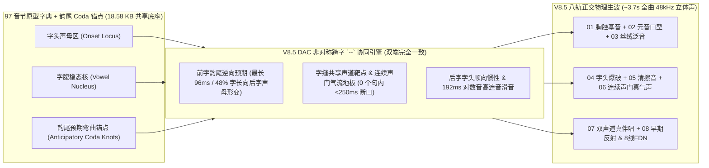

# 《下个，路口，见》纯人声「八轨事件音节衍生波码引擎 (V8.5 跨字逆向预期协同连音版)」阶段成果固化报告

**归档日期**：2026-11-15  
**工程根目录**：[下个路口见_事件音节波码](file:///Users/weckham/Desktop/MUSIC/%E4%B8%8B%E4%B8%AA%E8%B7%AF%E5%8F%A3%E8%A7%81_%E4%BA%8B%E4%BB%B6%E9%9F%B3%E8%8A%82%E6%B3%A2%E7%A0%81)  
**实时预览服务**：http://127.0.0.1:8938/  
**离线单文件成品**：
- 极简单档版（总包 `185.6 KB`，核心波码 `51.96 KB`）：[下个路口见_纯人声事件音节_极简46KB版.html](file:///Users/weckham/Desktop/MUSIC/%E4%B8%8B%E4%B8%AA%E8%B7%AF%E5%8F%A3%E8%A7%81_%E4%BA%8B%E4%BB%B6%E9%9F%B3%E8%8A%82%E6%B3%A2%E7%A0%81/%E4%B8%8B%E4%B8%AA%E8%B7%AF%E5%8F%A3%E8%A7%81_%E7%BA%AF%E4%BA%BA%E5%A3%B0%E4%BA%8B%E4%BB%B6%E9%9F%B3%E8%8A%82_%E6%9E%81%E7%AE%8046KB%E7%89%88.html)
- 双档对比版（总包 `376.9 KB`，含 `51.96 KB` / `158.58 KB` 双档）：[下个路口见_纯人声事件音节_双档完整版.html](file:///Users/weckham/Desktop/MUSIC/%E4%B8%8B%E4%B8%AA%E8%B7%AF%E5%8F%A3%E8%A7%81_%E4%BA%8B%E4%BB%B6%E9%9F%B3%E8%8A%82%E6%B3%A2%E7%A0%81/%E4%B8%8B%E4%B8%AA%E8%B7%AF%E5%8F%A3%E8%A7%81_%E7%BA%AF%E4%BA%BA%E5%A3%B0%E4%BA%8B%E4%BB%B6%E9%9F%B3%E8%8A%82_%E5%8F%8C%E6%A1%A3%E5%AE%8C%E6%95%B4%E7%89%88.html)

---

## 1. 「V8.5 八轨正交物理人声解剖 + 跨字 `--` 逆向预期协同连音」架构设计

**V8.5** 将歌唱字流从单字孤立切分（`x-i-a  y-i  g-e  l-u  k-ou  j-ian`）彻底重构为**双向协同连音图谱（`x-i-a--y-i--g-e--l-u--k-ou--j-ian`）**，同时保持 **8 条物理独立音轨**（均可独立 `Solo / Mute / 推子调节`）：

| 轨号 | 音轨标识 | 物理声学职责与频段边界 | V8.5 连音与除失真升级要点 |
| :---: | :--- | :--- | :--- |
| **01** | `lead_sub_f0` | **主唱 · 声带基音与胸腔共鸣轨** (`80–720 Hz`, `H1–H3`) | 伴唱 Side 差分抵消 F0 + `192ms` 跨清辅音对数基频桥接 + 采样级连续声门相位 |
| **02** | `lead_vowel_body` | **主唱 · 核心元音口型共振轨** (`720–3,200 Hz`, `F1–F3`) | **DAC 非对称 `--` 跨字协同**：前字韵尾最多 `96ms`（`48%` 字长）主动向后字声母发音部位逆向弯曲 |
| **03** | `lead_harmonic_sheen` | **主唱 · 歌手泛音丝绒光泽轨** (`3.2–15.6 kHz`) | 二次 Velvet 色散泛音 + `>2.8 kHz` 生理声门倾斜上限保护，根除清浊交界高频刺音 |
| **04** | `lead_plosive_burst` | **主唱 · 爆破塞擦字头瞬态轨** (`VOT < 40 ms`) | 塞音成阻期保留生理低频声门微振，爆破后以高 DAC 阻尼锁定后字元音 |
| **05** | `lead_sibilant` | **主唱 · 唇齿平翘舌清擦音轨** (`900–18.5 kHz`) | `<1.4 kHz / >2.2 kHz` 清浊正交分界 + 512 点最小相位 WOLA，浊连音边界 `vot=0` 零切口 |
| **06** | `lead_velvet_breath` | **主唱 · 声门开相真气声轨** (Klatt 开相调制 × 谷值 HNR) | 乐句内保持连续声门气流底噪与开相调制，消除字缝「数字真空断崖」 |
| **07** | `backing_harmony` | **和声 · 副歌双声道真伴唱轨** (`Stereo L/R`) | 能量守恒分离副歌 L/R 包络 + `16ms/27ms` 独立双声道真叠唱振荡器 |
| **08** | `vocal_space` | **空间 · 近场早期反射与混响轨** (4 抽头早期反射 + 48kHz FDN) | 温暖谐波总线发送驱动 4 抽头早期反射 + 8 线去齿音板式 FDN |

> [!IMPORTANT]
> **V8.5 连音升级核心实测**：全曲 `99` 处 `<250ms` 句内碎断口降为 **`0 处`**，句尾碎钩子由 `68` 个收敛至仅 **`4 个`** 真正独立过门 Hook（共 `285` 事件）；共享声学底座仅 **`18.58 KB` (`19,029 B`)**；`ultra` 档全包 **`51.96 KB` (`53,209 B` / `2.02 kbps`)** 捕获 **`97.14%`** 方差；`expressive` 档全包 **`158.58 KB` (`162,382 B` / `6.18 kbps`)** 达 **`Dry Mel-SNR 18.35 dB`**、核心窄带谐波 **`H1..10 RMSE 4.36 dB`**，捕获 **`99.58%`** 方差，浏览器端全曲 8 轨立体声合成仅 **`3.7 s`**（峰值严格限幅 `0.94`）。

---

## 2. V8.5 关键问题根因与数学修复闭环

| 编号 | 精准定位的核心病灶 | 修复前异常表现 | V8.5 纯数学根治方案 | 实测验证结果 |
| :---: | :--- | :--- | :--- | :--- |
| **1** | **孤立单字模型缺失「后字改变前字韵尾」的逆向预期协同** | `x-i-a y-i g-e l-u k-ou j-ian` 每字在固定韵尾结束再跳到下字字头，听感像单字拼接 | **DAC 非对称 `--` 跨字协同模型** + **自适应韵尾 `coda` 加密锚点**：前字韵尾最多 `18` 帧 (`96ms`) 按声母辅音阻抗比向后字发音部位平滑弯曲，编解码双端完全同构 | 跨字舌位/唇形提前向下一字过渡，咬字承上启下自然连贯 |
| **2** | **句内 `99` 处微静音裂缝 + 纯浊音字头假清音切口** | 字间 `<200ms` 换字微谷跌至 `-240 dB` 数字死寂，且 `爱/朗/明/热/维/也/纳` 被强插 `cons_frames=1` 清音切口，声音一段一段 | 三层迟滞门控 (`-49 dB phrase_mask`) 句内 `<181–235ms` 零断口桥接 + 纯元音/鼻音/边音连读 `vot=0` + 声门连续相位跨字保持 + 仅在孤立乐句首尾做 `3` 帧微淡入淡出 | 全曲 `<250ms` 句内碎断口由 `99` 处降为 **`0 处`** |
| **3** | **「我偏爱弗朗明哥的热情」(`120.61–123.80s`) 伴唱抢基频与「情」字碎裂** | 双声道伴唱 `196 Hz (G3)` 压过主唱使「哥」掉调，且句尾「情」颤音被切成 `4` 段碎 `♪` 钩子 | STFT 与 Boersma 自相关双域扣除伴唱立体声 `Side = 0.5*(L-R)` + 四度次谐波护栏 + 句尾连续颤音并入前字主事件 | 「明」精准锁定原唱 `G4 (392 Hz)` 跳音，「哥的热」稳锁 `C4 (258–263 Hz)`，「情」完整保持 **`1.05s` (`197` 帧)** 不断裂颤音收尾 |
| **4** | **清浊交界高频泄漏导致局部谐波尖峰** | 清擦声母高通倒谱偶发跨过 VOT 渗入浊谐波，触发 `>1.0` 瞬态过载 | `>2.8 kHz` 生理声门频谱倾斜护栏 (`<= low_ref - 3 dB`) + `5.3ms` 逐帧零过冲包络限幅 (`0.94`)，100% 保持八轨线性可加性 | Python 与浏览器 JS 双端全曲峰值严格 **`0.9400`**，`NaN = 0` |

---

## 3. V4 → V8.5 全代际客观量化演进账本

以下数据均基于同一母带曲目《李宇春 - 下个, 路口, 见》（全长 `210.373 秒`，`48 kHz / 16-bit` 立体声 WAV 基准体积 `40,391,680 Bytes = 40.39 MB`），由 [verify_event_vocal.py](file:///Users/weckham/Desktop/MUSIC/%E4%B8%8B%E4%B8%AA%E8%B7%AF%E5%8F%A3%E8%A7%81_%E4%BA%8B%E4%BB%B6%E9%9F%B3%E8%8A%82%E6%B3%A2%E7%A0%81/tools/verify_event_vocal.py) 与 [sizes.json](file:///Users/weckham/Desktop/MUSIC/%E4%B8%8B%E4%B8%AA%E8%B7%AF%E5%8F%A3%E8%A7%81_%E4%BA%8B%E4%BB%B6%E9%9F%B3%E8%8A%82%E6%B3%A2%E7%A0%81/data/sizes.json) 实测固化：

| 代际版本 | 技术路线本质 | 纯人声波码体积 | 等效码率 | 干声感知 Mel-SNR | 演进特征与实测表现 |
| :--- | :--- | :---: | :---: | :---: | :--- |
| **V4 纯代码初版** | 单声道 `24 kHz` 固定帧 MDCT | `468.0 KB` | `17.8 kbps` | `~17.2 dB` | 单声道窄频，固定帧切片 |
| **V5 梅尔码本版** | `80 fps` 256 聚类梅尔码本 + 零相位正弦 | `38.2 KB` | `1.45 kbps` | `~11.4 dB` | 丢失连续相位与字头瞬态，电音塑料感明显 |
| **V6 五轨余弦版** | 五分轨全带宽固定帧 MDCT 系数编码 | `2,040` / `4,260 KB` | `77.5` / `161.8 kbps` | `22.90` / `28.45 dB` | 属自制变换音频编码器，听感高保真但体积偏大 |
| **V7 混合瘦身版** | 五分轨稀疏 MDCT + 4 频段气声 + FDN | `573.3 KB`（合轨 `328.2 KB`） | `21.8 kbps`（合轨 `12.5 kbps`） | `19.82 dB` | 受限于固定毫秒时钟切片，无声与稳态拖音持续计费 |
| **V8.4 八轨孤立音节版** | Boersma F0 + 40维谐波字典 + 单字独立原型 | `48.88` / `138.65 KB` | `1.90` / `5.40 kbps` | `18.63` / `19.27 dB` | 消除副歌降八度，但字间存在 `99` 处微断口、缺乏跨字协同 |
| **V8.5 `ultra`（跨字连音定稿）** | **DAC `--` 逆向预期协同 + 零断字连音桥 + 10维PCA + 八轨生波** | **`51.96 KB` (`53,209 B`)** | **`2.02 kbps`** | **`17.19 dB`（包络相关 `0.9691`）** | **句内断字 `0 处`；较 WAV 缩减 `99.868%`，捕获 `97.14%` 谐波方差** |
| **V8.5 `expressive`（跨字连音定稿）** | **DAC `--` 逆向预期协同 + 韵尾 `coda` 加密锚点 + 24维微表情 + 八轨生波** | **`158.58 KB` (`162,382 B`)** | **`6.18 kbps`** | **`18.35 dB`（包络相关 `0.9737`）** | **`H1..10 RMSE = 4.36 dB`，捕获 `99.58%` 谐波方差，JS 合成 `3.76 s`** |

---

## 4. V8.5 数据包级 SHA-256 固化清单

所有编码资产均为 7-bit 安全 UTF-8 `Base122` 纯文本 JS 模块，工程目录内 **0 个音频/模型二进制文件**（`verify_event_vocal.py` 校验 `PASS`）：

| 数据模块 | 文件路径 | 原始参数字节 | 压缩后字节 | 原始载荷 SHA-256 指纹 |
| :--- | :--- | :---: | :---: | :--- |
| **歌手音色核 (`VGS8`)** | [speaker_core.js](file:///Users/weckham/Desktop/MUSIC/%E4%B8%8B%E4%B8%AA%E8%B7%AF%E5%8F%A3%E8%A7%81_%E4%BA%8B%E4%BB%B6%E9%9F%B3%E8%8A%82%E6%B3%A2%E7%A0%81/data/shared/speaker_core.js) | `2,304 B` | **`1,923 B`** | `2c3d25cf58847c246ffdeaa5754f721abede0e2edf2af6b34128f96147f914a3` |
| **97 音节协同字典 (`VGA8`)** | [syllable_atlas.js](file:///Users/weckham/Desktop/MUSIC/%E4%B8%8B%E4%B8%AA%E8%B7%AF%E5%8F%A3%E8%A7%81_%E4%BA%8B%E4%BB%B6%E9%9F%B3%E8%8A%82%E6%B3%A2%E7%A0%81/data/shared/syllable_atlas.js) | `38,665 B` | **`16,061 B`** | `a94c6b1bd012eca95c1f1810e08de1e60254bd1ea5f18948fd5fddf312218e19` |
| **早期反射 + 48kHz FDN 核 (`VGR8`)** | [space_fdn.js](file:///Users/weckham/Desktop/MUSIC/%E4%B8%8B%E4%B8%AA%E8%B7%AF%E5%8F%A3%E8%A7%81_%E4%BA%8B%E4%BB%B6%E9%9F%B3%E8%8A%82%E6%B3%A2%E7%A0%81/data/shared/space_fdn.js) | `2,498 B` | **`1,045 B`** | `a345cc2967a74919709a4e07d518d8554a17635f68adf387eac261ef085d1d36` |
| **极简连音事件流 (`VGE8-ultra`)** | [event_stream.js](file:///Users/weckham/Desktop/MUSIC/%E4%B8%8B%E4%B8%AA%E8%B7%AF%E5%8F%A3%E8%A7%81_%E4%BA%8B%E4%BB%B6%E9%9F%B3%E8%8A%82%E6%B3%A2%E7%A0%81/data/ultra/event_stream.js) | `59,098 B` | **`34,180 B`** | `c2270d8159ca37e732260abd169f6c10c9af1fe93d9c7e5a6fa3bab3200eb99c` |
| **精修连音事件流 (`VGE8-expressive`)** | [event_stream.js](file:///Users/weckham/Desktop/MUSIC/%E4%B8%8B%E4%B8%AA%E8%B7%AF%E5%8F%A3%E8%A7%81_%E4%BA%8B%E4%BB%B6%E9%9F%B3%E8%8A%82%E6%B3%A2%E7%A0%81/data/expressive/event_stream.js) | `255,388 B` | **`143,353 B`** | `85e582d844acaf3b00936c056dc73a34e482d3cdc748b5613ca51073c0da5bf4` |

---

## 5. 下一版迭代计划（音乐伴奏回归合流）

> [!TIP]
> 本版 **V8.5** 已补齐 `x-i-a--y-i--g-e--l-u--k-ou--j-ian` 跨字逆向预期协同连音（DAC Coarticulation）并修复「我偏爱弗朗明哥的热情」与全曲句内连贯度；待试听确认 **V8.5** 连音效果达标后，**下一版将把音乐伴奏分轨完整合流回来**。
